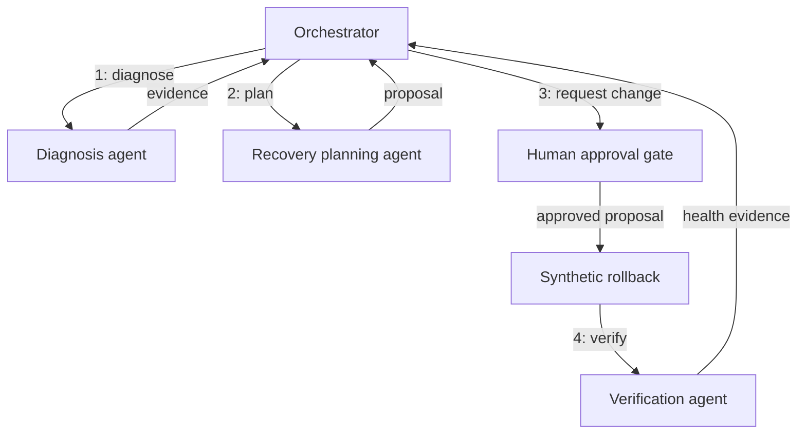

# Relay Ops Orchestrator

[](https://github.com/blueRav/relay-ops-agent/actions/workflows/ci.yml)

An incident orchestrator that delegates diagnosis, recovery planning, and independent verification to separate specialist agents, with a human approval gate before a rollback.

A runnable portfolio prototype by Antoine Morales. Node.js 22+, JavaScript ESM, no third-party runtime dependencies. All logs, metrics, deployments, and effects are synthetic.

## Agent roles

| Agent | Responsibilities | Permitted tools |
| --- | --- | --- |
| Orchestrator | Route work, coordinate handoffs, request approval, combine results | delegate_triage, delegate_recovery_planning, apply_rollback, delegate_verification |
| Diagnosis specialist | Gather incident evidence | get_metrics, search_logs |
| Recovery planning specialist | Build a runbook-backed rollback proposal | list_deployments, read_runbook |
| Verification specialist | Independently verify current health | get_metrics |

Every specialist has a separate bounded agent loop, role instructions, completion validator, and trace. Specialists cannot write service state. The coordinator accepts structured evidence handoffs rather than trusting a success claim.

## Run locally

```bash
git clone https://github.com/blueRav/relay-ops-agent.git
cd relay-ops-agent
npm ci --ignore-scripts
npm test
npm run demo
# Review the exact pending rollback, then approve the synthetic action:
node src/cli.mjs --resume --approve --reviewer Antoine
```

The default scenario investigates a connection-pool incident in transcript-api. The diagnosis and planning agents run first; the coordinator pauses before changing v12 to v11. After approval, the verification specialist reads new metrics.

State, receipts, all handoffs, and all agent traces are saved to .state/run.json. [Sample run](examples/sample-run.json) contains the actual deterministic trace.

## Routing and approval



An already-healthy service skips recovery planning and rollback. Failed specialist evidence blocks completion. A changed deployment invalidates the pending proposal. Only the exact specialist proposal can reach execution, and duplicate approved writes reuse their receipt.

See [orchestration design](docs/orchestration.md) for handoffs, role budgets, and routing.

## Optional live coordinator

Copy .env.example to .env, set your own OPENAI_API_KEY and OPENAI_MODEL, then run npm run live. The model must support Responses API function tools. This makes billable model calls.

Live mode uses a model to coordinate the same delegation tools; specialists remain deterministic observation-driven agents. The offline demo and CI use no model API. No AWS resources are accessed or changed.

## Repository map

| Path | Purpose |
| --- | --- |
| src/project.mjs | Coordinator tools, routing, domain guards, and fixture |
| src/specialists.mjs | Three specialist agents, capability subsets, and evidence handoffs |
| src/agent.mjs | Shared bounded runtime, schema validation, approvals, and receipts |
| src/provider.mjs | Optional live coordinator adapter |
| src/cli.mjs | Checkpoint persistence and approval resume |
| test/ | Runtime, orchestration, and CLI subprocess checks |

[Runtime design](docs/runtime.md) explains the enforcement boundary. [Development notes](docs/development.md) document the workflow and verification.

## Scope and limitations

This is a local orchestration prototype. Reviewer names are labels rather than authentication, and checkpoint files are trusted local inputs. Receipts are not exactly-once transactions across crashes. Token ceilings are checked after responses and are not strict spending caps. Specialist handoffs are cached for the synthetic scenario; real incident data would need freshness and invalidation rules.

A production AWS adapter, IAM policy, durable checkpoint service, authenticated review system, and real rollback validation are future work. Synthetic recovery metrics must not be presented as measured production results.

## Related projects

- [Evidence Trail Agent](https://github.com/blueRav/evidence-trail-agent) — retrieval and verified evidence.
- [Minute Keeper Agent](https://github.com/blueRav/minute-keeper-agent) — persistent task memory.
- [Dataset Scout Agent](https://github.com/blueRav/dataset-scout-agent) — constrained experimentation.
- [Agent Gauntlet](https://github.com/blueRav/agent-gauntlet) — completion and safety evaluation.

MIT license. Developed with AI assistance; behavior and limitations are visible in the source and tests.
